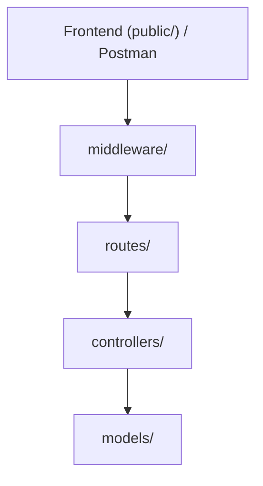
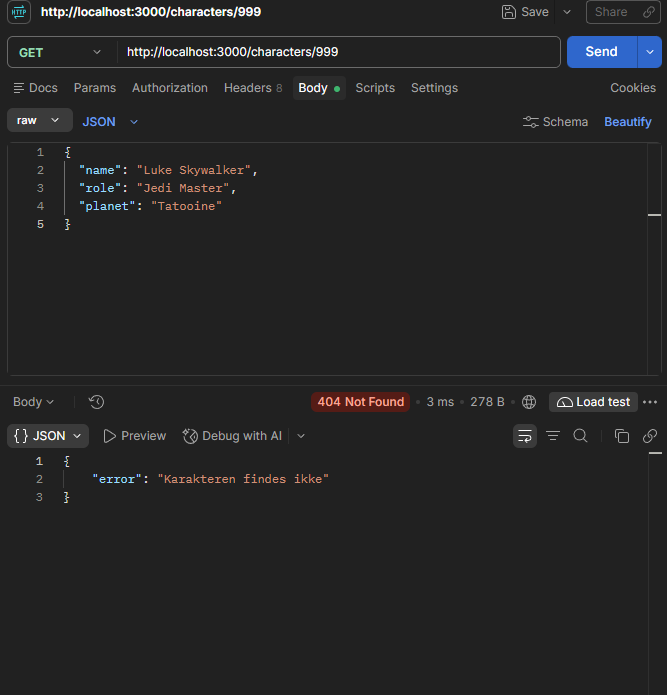
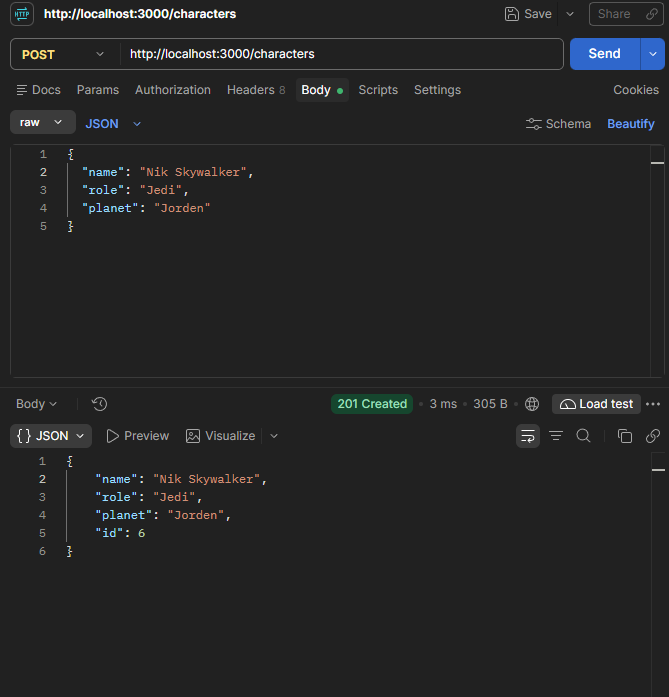
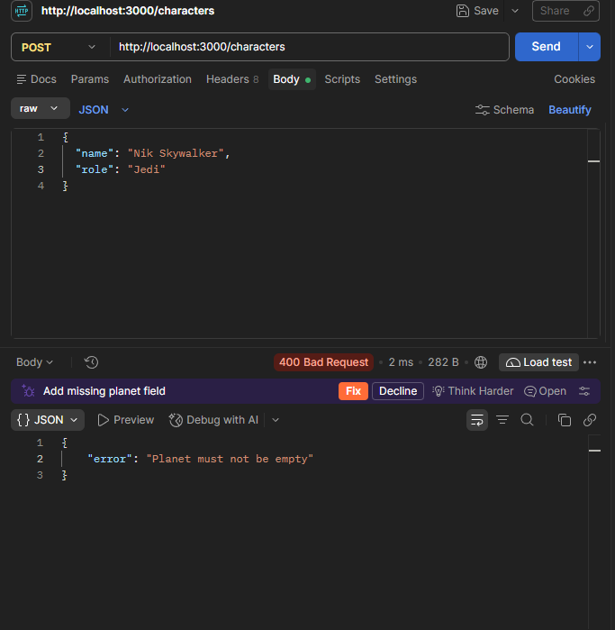
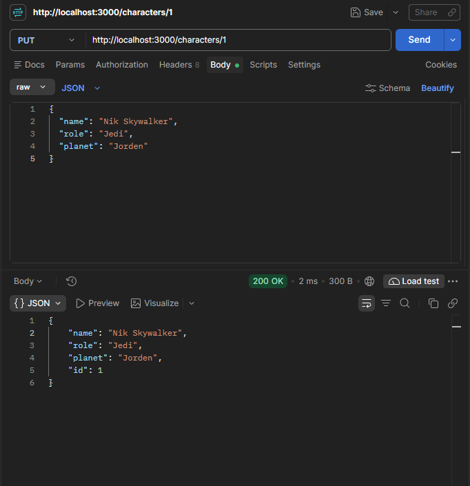

## Valgt projektstruktur
 
```
projektmappe/
├── public/            Frontend: index.html, main.js, style.css (serveres med express.static)
├── src/
│   ├── routes/        Kun routing: hvilke URL'er og metoder findes, og hvilken controller-funktion håndterer dem
│   ├── controllers/   Læser req (params/body), kalder modellen, sender response med korrekt statuskode
│   ├── models/        Det midlertidige data-array og funktioner til at hente, oprette, erstatte og slette karakterer, inkl. ID-generering. Eksporterer funktioner, ikke selve arrayet
│   ├── middleware/    Logging, inputvalidering, 404-handler for ukendte routes, central error-handler
│   └── app.js         Opretter Express-app, registrerer middleware og routes, eksporterer app
├── postman/           Postman Collection "Star Wars API"
├── rebel-alliance.txt Fil til GET /download (uden for public/, så den kun hentes via /download)
├── server.js          Importerer app fra src/app.js og kalder listen (port 3000)
└── README.md          Arkitektur, Mermaid-diagram, begrundelser og kode-review
```
## Mermaid diagram


## Arkitektur

- **HTTP-requests:** `routes/` definerer endpoints, `controllers/` læser request og sender response med statuskode.
- **Data:** `models/` indeholder arrayet og funktionerne til CRUD og ID-generering. Kun models rører arrayet.
- **Validering:** `middleware/` stopper ugyldige requests, før de når controller og model.

**Hvorfor det giver mening for os:**
- API'et har kun én ressource og et array som database. Derfor er tre lag nok, og vi har undgået lag uden eget ansvar.
- Opgaven kræver, at ugyldige requests ikke ændrer data. Derfor ligger valideringen før controlleren, og kun `models/` må ændre arrayet.
- Statuskoder er en stor del af opgaven, så de er samlet i controllers ét sted.

**Ulemper:** Data forsvinder ved genstart. Hver route skal huske at bruge validerings-middleware.

*Fravalgt:** Separate `services/` og `data/`. Med kun et array ville service-laget bare sende kald videre. Bliver projektet større, fx med en database, vil vi dele `models/` op.

## Midlertidig data i hukommelsen

`src/models/characterModel.js` bruger et array som midlertidig database. Derfor er data kun tilgængelige, mens Node-serveren kører. Når serveren genstartes, bliver filen indlæst igen med de oprindelige hardkodede karakterer. Karakterer, der er oprettet, ændret eller slettet under den forrige kørsel, går dermed tabt.

Det er også en dårlig idé at bruge arrayets længde som ID, for eksempel `characters.length + 1`. Hvis der er fire karakterer, og karakteren med ID 2 slettes, er arrayets længde 3. Den næste karakter ville så få ID 4, selv om der allerede findes en karakter med ID 4. Det giver to karakterer med samme ID.

I den nuværende løsning tæller `nextId` i modellen i stedet op for hver ny karakter, så et ID ikke genbruges efter en sletning, mens serveren kører. Ved en genstart nulstilles tælleren dog sammen med arrayet. I produktion bruges en rigtig database, fordi den gemmer data mellem genstarter og kan håndtere unikke ID'er mere robust, også når flere brugere eller servere arbejder med de samme data.

## Postman test cases

GET {{baseUrl}}/characters - Hent alle (200)


GET {{baseUrl}}/characters/1 - Hent eksisterende (200)


GET {{baseUrl}}/characters/999 - Hent ikke-eksisterende (404)


POST {{baseUrl}}/characters - Opret ny (201)


POST {{baseUrl}}/characters - Opret uden navn (400)


POST {{baseUrl}}/characters - Opret med ugyldig rolle (400)
!

POST {{baseUrl}}/characters - Opret uden planet (400)


PUT {{baseUrl}}/characters/1  - Opdater eksisterende (200)


PUT {{baseUrl}}/characters/999 - Opdater ikke-eksisterende (404)


- DELETE {{baseUrl}}/characters/4 - Slet eksisterende (204 og tom response-body)


- DELETE {{baseUrl}}/characters/999 - Slet ikke-eksisterende (404)

