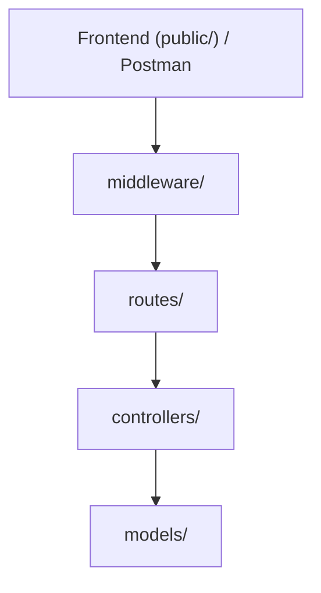
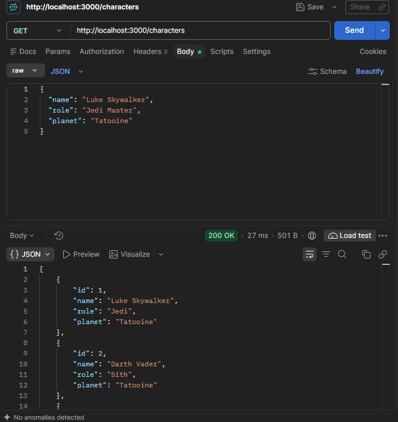
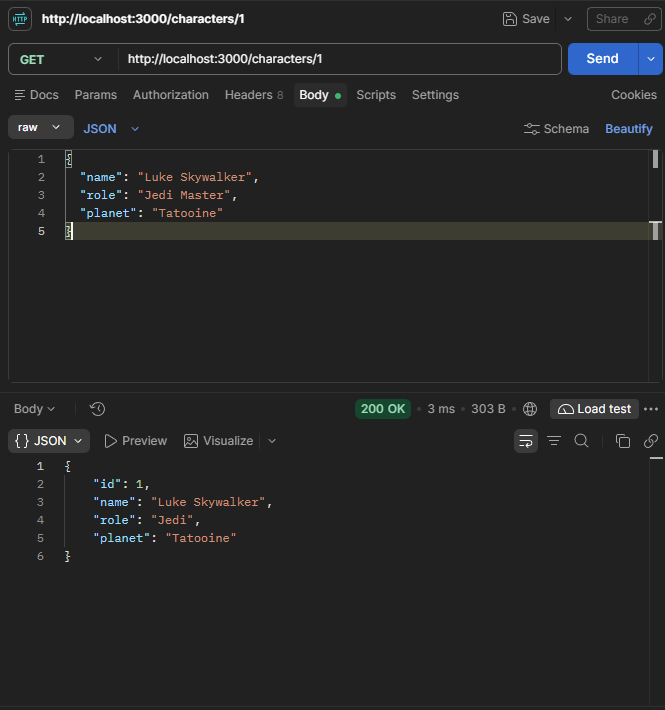
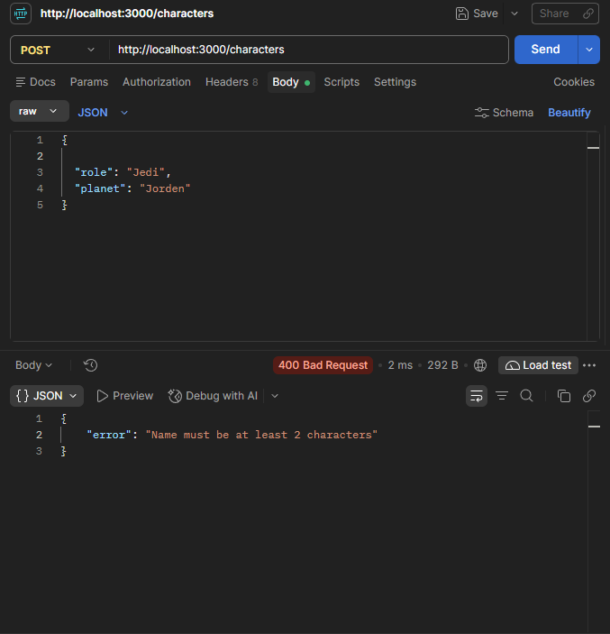
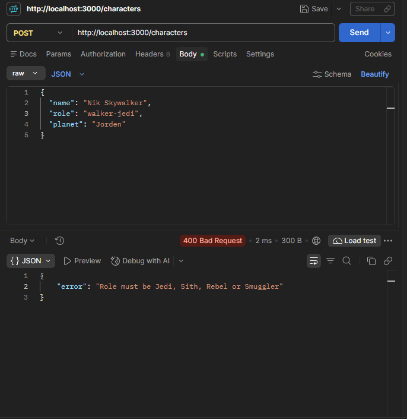
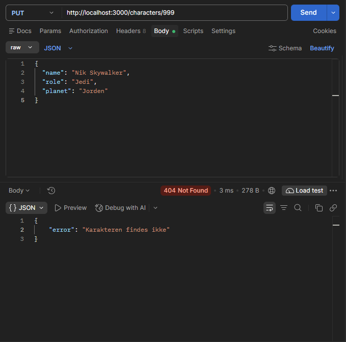
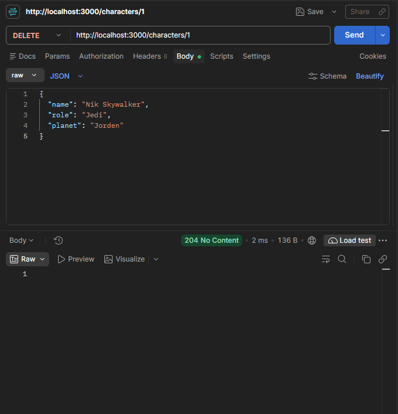
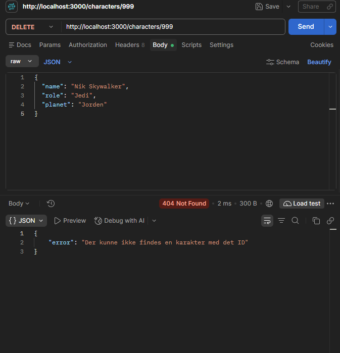

## Valgt projektstruktur
 
```
projektmappe/
├── public/            Frontend: index.html, main.js, style.css (serveres med express.static)
├── src/
│   ├── routes/        Kun routing: hvilke URL'er og metoder findes, og hvilken controller-funktion håndterer dem
│   ├── controllers/   Læser req (params/body), kalder modellen, sender response med korrekt statuskode
│   ├── models/        Det midlertidige data-array og funktioner til at hente, oprette, erstatte og slette karakterer, inkl. ID-generering. Eksporterer funktioner, ikke selve arrayet
│   ├── middleware/    Logging, inputvalidering, 404-handler for ukendte routes, central error-handler
│   └── app.js         Opretter Express-app, registrerer middleware og routes, eksporterer app
├── postman/           Postman Collection "Star Wars API"
├── rebel-alliance.txt Fil til GET /download (uden for public/, så den kun hentes via /download)
├── server.js          Importerer app fra src/app.js og kalder listen (port 3000)
└── README.md          Arkitektur, Mermaid-diagram, begrundelser og kode-review
```
## Mermaid diagram


## Arkitektur

- **HTTP-requests:** `routes/` definerer endpoints, `controllers/` læser request og sender response med statuskode.
- **Data:** `models/` indeholder arrayet og funktionerne til CRUD og ID-generering. Kun models rører arrayet.
- **Validering:** `middleware/` stopper ugyldige requests, før de når controller og model.

**Hvorfor det giver mening for os:**
- API'et har kun én ressource og et array som database. Derfor er tre lag nok, og vi har undgået lag uden eget ansvar.
- Opgaven kræver, at ugyldige requests ikke ændrer data. Derfor ligger valideringen før controlleren, og kun `models/` må ændre arrayet.
- Statuskoder er en stor del af opgaven, så de er samlet i controllers ét sted.

**Ulemper:** Data forsvinder ved genstart. Hver route skal huske at bruge validerings-middleware.

**Fravalgt:** Separate `services/` og `data/`. Med kun et array ville service-laget bare sende kald videre. Bliver projektet større, fx med en database, vil vi dele `models/` op.

## Dokumentation af ID-strategi og datalagring

`src/models/characterModel.js` bruger et array som midlertidig database. Derfor er data kun tilgængelige, mens Node-serveren kører. Når serveren genstartes, bliver filen indlæst igen med de oprindelige hardkodede karakterer. Karakterer, der er oprettet, ændret eller slettet under den forrige kørsel, går dermed tabt.

Det er også en dårlig idé at bruge arrayets længde som ID, for eksempel `characters.length + 1`. Hvis der er fire karakterer, og karakteren med ID 2 slettes, er arrayets længde 3. Den næste karakter ville så få ID 4, selv om der allerede findes en karakter med ID 4. Det giver to karakterer med samme ID.

I den nuværende løsning tæller `nextId` i modellen i stedet op for hver ny karakter, så et ID ikke genbruges efter en sletning, mens serveren kører. Ved en genstart nulstilles tælleren dog sammen med arrayet. I produktion bruges en rigtig database, fordi den gemmer data mellem genstarter og kan håndtere unikke ID'er mere robust, også når flere brugere eller servere arbejder med de samme data.

## Postman test cases

GET {{baseUrl}}/characters - Hent alle (200)



GET {{baseUrl}}/characters/1 - Hent eksisterende (200)



GET {{baseUrl}}/characters/999 - Hent ikke-eksisterende (404)


POST {{baseUrl}}/characters - Opret ny (201)


POST {{baseUrl}}/characters - Opret uden navn (400)



POST {{baseUrl}}/characters - Opret med ugyldig rolle (400)

!

POST {{baseUrl}}/characters - Opret uden planet (400)


PUT {{baseUrl}}/characters/1  - Opdater eksisterende (200)


PUT {{baseUrl}}/characters/999 - Opdater ikke-eksisterende (404)



DELETE {{baseUrl}}/characters/4 - Slet eksisterende (204 og tom response-body)



DELETE {{baseUrl}}/characters/999 - Slet ikke-eksisterende (404)


## Eksperiment: middleware og statuskoder (US-12)

### Eksperiment: `next()` fjernet fra logging-middleware

**Hvad vi gjorde:** I `src/middleware/logger.js` kommenterede vi midlertidigt `next()` ud og sendte `GET /characters`.

**Resultat:** Requesten blev logget i konsollen (`GET /characters`), men klienten fik aldrig noget svar. Forbindelsen hang, til klienten gav op (timeout efter 4 sekunder i vores test). Der kom ingen statuskode og ingen fejlbesked, og serveren crashede ikke.

**Forklaring:** Express kører middleware i den rækkefølge, de er registreret. En middleware har to muligheder: sende et svar eller kalde `next()` for at give requesten videre til den næste. Gør den ingen af delene, stopper kæden, og routes, controllers og 404-handler bliver aldrig nået. Express ved ikke, at middleware'en er "færdig", så requesten bliver bare hængende. Derfor skal `next()` være med i alle middleware, der ikke selv sender et svar. Eksperimentet blev kørt med et lille Node-script frem for Postman, men resultatet er det samme, som man ser i Postman: "Sending request..." uden ende.

`next()` er sat tilbage i `logger.js`, og ingen eksperimentkode er committet.

### Forskellen på 400, 404 og 500

| Kode | Betydning | Hvis skyld | Eksempel i vores API |
|------|-----------|------------|----------------------|
| **400 Bad Request** | Requesten er ugyldig. Serveren forstår den ikke eller afviser dens indhold | Klienten | `POST /characters` med `name` på ét tegn, ugyldig `role` eller tom `planet` (`validateCharacter`), eller ugyldig JSON |
| **404 Not Found** | Requesten er fin, men den ressource der peges på, findes ikke | Klienten | `GET /characters/999` med et ID, der ikke findes, eller en ukendt URL (`notFound`) |
| **500 Internal Server Error** | Serveren fejlede uventet, mens den behandlede en gyldig request | Serveren | En ufanget exception i en controller eller model (`errorHandler`) |

Tommelfingerregel: **4xx** betyder "klienten skal rette noget", **5xx** betyder "serveren har et problem". Samme request kan prøves igen uændret ved 5xx, men ikke ved 4xx.

### Hvorfor "karakter findes ikke" ikke er 500

At en karakter ikke findes, er ikke en fejl i serveren. Serveren har gjort præcis det, den skal: slået ID'et op og fundet ud af, at der ikke er noget. Det er et forventet udfald, som sker ved helt normal brug (fx en slettet karakter eller en tastefejl i ID'et), og det er klientens request, der peger på noget forkert. Derfor returnerer controlleren `404` med beskeden "Karakteren findes ikke" via `return res.status(404)...`.

500 er forbeholdt det uventede, fx en bug eller en exception. Hvis "findes ikke" gav 500, ville vi ikke kunne se forskel på almindelig brugerfejl og rigtige serverfejl i logs og overvågning, og klienten ville tro, at det kunne hjælpe at prøve igen.

## `res.download()` og `res.redirect()`

`res.download()` sender en fil til klienten som en download. Express sætter de relevante HTTP-headere, blandt andet `Content-Disposition: attachment`, så browseren typisk gemmer filen i stedet for at vise den. I dette projekt henter `GET /download` filen `rebel-alliance.txt`.

`res.redirect()` sender et redirect-svar til klienten. Svaret indeholder en `Location`-header med den nye adresse, hvorefter browseren eller klienten laver en ny request til den adresse. `GET /go-to-luke` redirecter for eksempel til `/characters/1`.

Man kan ikke bruge begge metoder på samme request, fordi et HTTP-request kun kan have ét response. Både `res.download()` og `res.redirect()` sender et afsluttende svar med headers og response-body. Når det første svar er sendt, er headers allerede sendt til klienten, og Express kan derfor ikke sende et andet svar. Det vil normalt give fejlen `Cannot set headers after they are sent to the client`.


