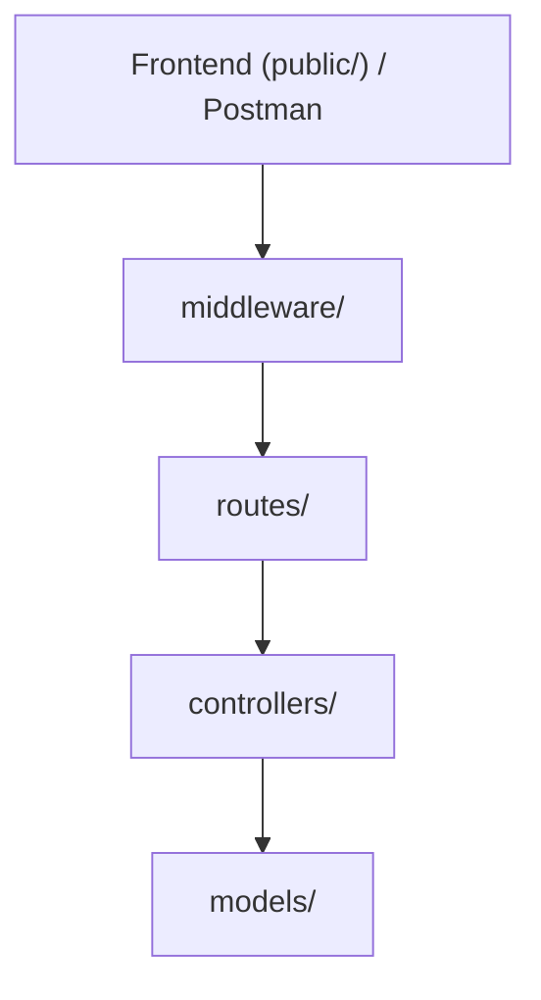

## Valgt projektstruktur
 
```
projektmappe/
├── public/            Frontend: index.html, main.js, style.css (serveres med express.static)
├── src/
│   ├── routes/        Kun routing: hvilke URL'er og metoder findes, og hvilken controller-funktion håndterer dem
│   ├── controllers/   Læser req (params/body), kalder modellen, sender response med korrekt statuskode
│   ├── models/        Det midlertidige data-array og funktioner til at hente, oprette, erstatte og slette karakterer, inkl. ID-generering. Eksporterer funktioner, ikke selve arrayet
│   ├── middleware/    Logging, inputvalidering, 404-handler for ukendte routes, central error-handler
│   └── app.js         Opretter Express-app, registrerer middleware og routes, eksporterer app
├── postman/           Postman Collection "Star Wars API"
├── rebel-alliance.txt Fil til GET /download (må IKKE ligge i public/)
├── server.js          Importerer app fra src/app.js og kalder listen (port 3000)
└── README.md          Arkitektur, Mermaid-diagram, begrundelser og kode-review
```
## Mermaid diagram


## Arkitektur

- **HTTP-requests:** `routes/` definerer endpoints, `controllers/` læser request og sender response med statuskode.
- **Data:** `models/` indeholder arrayet og funktionerne til CRUD og ID-generering. Kun models rører arrayet.
- **Validering:** `middleware/` stopper ugyldige requests, før de når controller og model.

**Hvorfor det giver mening for os:**
- API'et har kun én ressource og et array som database. Derfor er tre lag nok, og vi har undgået lag uden eget ansvar.
- Opgaven kræver, at ugyldige requests ikke ændrer data. Derfor ligger valideringen før controlleren, og kun `models/` må ændre arrayet.
- Statuskoder er en stor del af opgaven, så de er samlet i controllers ét sted.

**Ulemper:** Data forsvinder ved genstart. Hver route skal huske at bruge validerings-middleware.

**Fravalgt:** Separate `services/` og `data/`. Med kun et array ville service-laget bare sende kald videre. Bliver projektet større, fx med en database, vil vi dele `models/` op.


